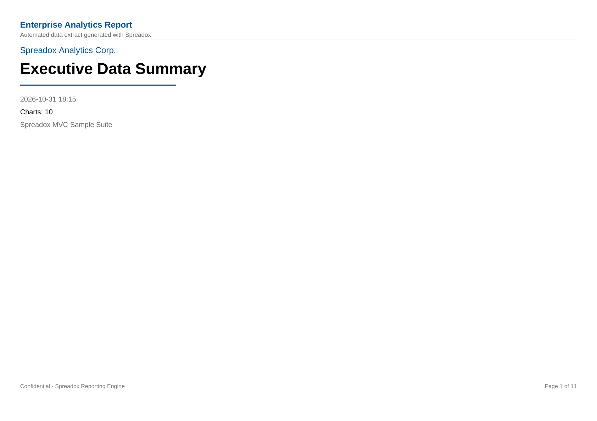
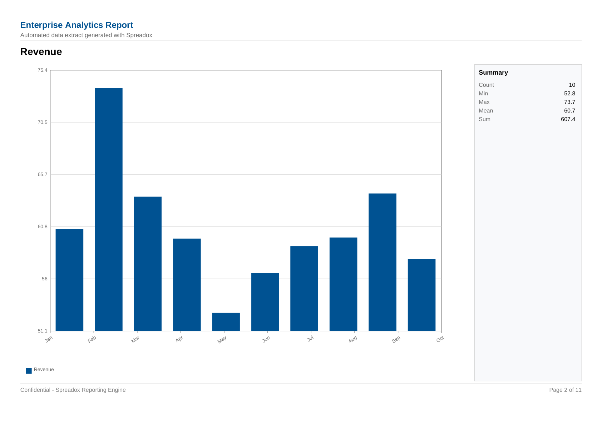
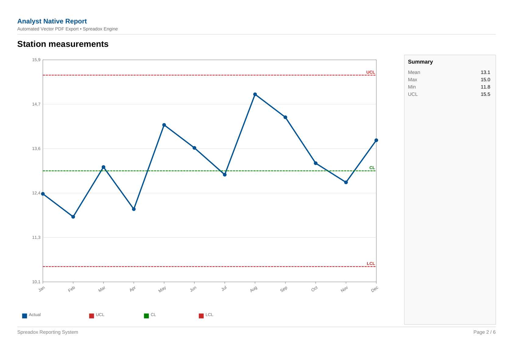
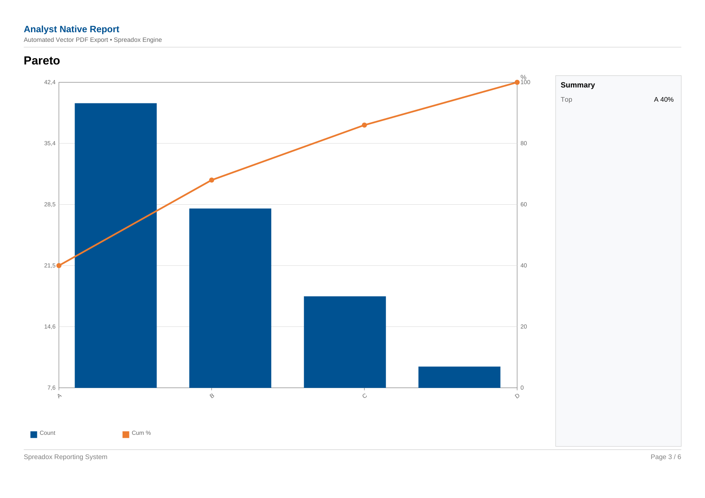
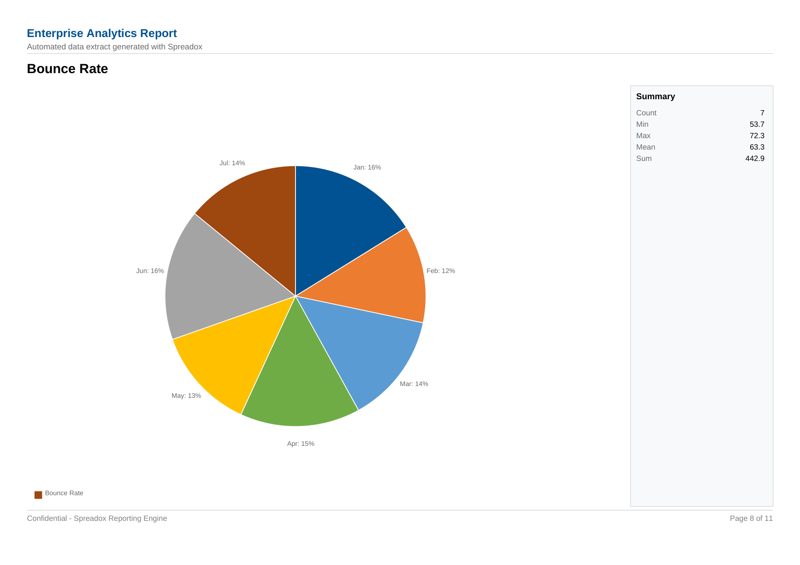
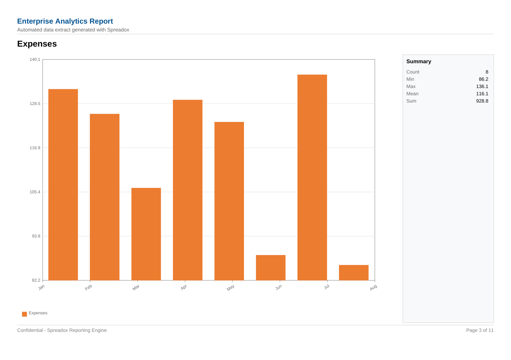
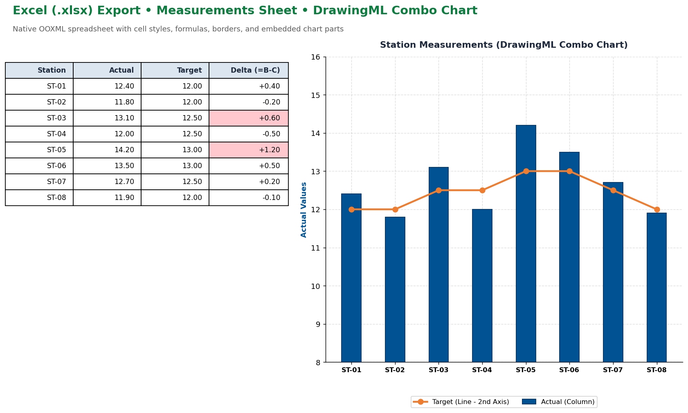

# Spreadox

[](https://www.nuget.org/packages/Conq.Noble.Spreadox)
[](https://github.com/FatihBaycu/Conq.Noble.Spreadox/actions/workflows/ci.yml)
[](LICENSE)

High-level, dependency-isolated C# library for **native Excel (`.xlsx`) workbooks** and **vector A4 landscape PDF chart reports**.

- **Excel:** Built on Microsoft Open XML SDK (`DocumentFormat.OpenXml`). Open XML types remain internal so your code stays clean. Supports cell styles, formulas, borders, colors, pictures, and native OOXML DrawingML charts.
- **PDF:** Sharp, scalable vector charts drawn directly from in-memory arrays (powered by `PdfSharpCore`). Includes cover pages, customizable running headers/footers with logos, metric summaries, and runtime TrueType (`.ttf`) font registration.

| | |
|---|---|
| **Package** | `Conq.Noble.Spreadox` |
| **Namespace** | `Conq.Noble.Spreadox` |
| **Target** | `netstandard2.0` (.NET Framework 4.8+, .NET 6/8/9+) |
| **Release Notes** | [CHANGELOG.md](CHANGELOG.md) |
| **License** | MIT |

---

## Visual Output Examples

### Vector PDF Reports (`PdfReport` & MVC Studio)

Vector charts rendered crisply at any zoom level, with running headers, logos, summary sidebars, and control lines.

| MVC Studio Cover Page | Radar Chart & Header (from MVC Studio) |
|:---:|:---:|
|  |  |

| Station Measurements (Line + UCL/LCL) | Pareto Combo (Bar + Secondary Line) |
|:---:|:---:|
|  |  |

| Bounce Rate (Pie Chart & Summary) | Bar Chart (with Summary Metrics) |
|:---:|:---:|
|  |  |

### Native Excel Spreadsheets (`ExcelWorkbook`)

Standard OOXML DrawingML charts linked to spreadsheet cell ranges with native formatting and styles.

| Excel Spreadsheet with Combo Chart and Summary Grid |
|:---:|
|  |

---

## Install via NuGet

```bash
dotnet add package Conq.Noble.Spreadox
```

Package Manager:
```powershell
Install-Package Conq.Noble.Spreadox
```

---

## Quick Usage: Excel Workbook

```csharp
using Conq.Noble.Spreadox;

using var wb = ExcelWorkbook.Create();
var sheet = wb.Worksheets[0];
sheet.Name = "Demo";

// Formatted cells
sheet["A1"].SetValue("hello");
sheet["A1"].Style.Font.Bold = true;
sheet["B1"].SetValue(0.25);
sheet["B1"].Style.NumberFormat = NumberFormats.Percent;
sheet.SetFormula("D1", "B1*100", cachedValue: 25);
sheet.FreezePanes(1);

// Add clustered column chart
var chart = sheet.Charts.Add(ExcelChartType.ColumnClustered, "Demo chart");
chart.AddSeries("B2:B10", "A2:A10", name: "Values");
chart.SetPosition(2, 4, 16, 12);

// Add combo chart (Columns on primary axis, Line on secondary axis)
var combo = sheet.Charts.Add(ExcelChartType.Combo, "Combo");
combo.AddSeries("B2:B10", "A2:A10", name: "Bars").AsChartType(ExcelChartType.ColumnClustered);
combo.AddSeries("C2:C10", "A2:A10", name: "Line").AsChartType(ExcelChartType.Line).OnSecondaryAxis();
combo.SetPosition(2, 13, 16, 20);

wb.Save(@"C:\temp\demo.xlsx");
```

### High-Volume Streaming (100k+ rows)

```csharp
using (var sw = ExcelStreamingWorkbook.Create(@"C:\temp\large.xlsx"))
{
    var big = sw.AddWorksheet("Rows");
    for (int r = 1; r <= 100_000; r++)
    {
        big.WriteRow(r, row =>
        {
            row.Text(1, "R" + r);
            row.Number(2, r);
        });
    }
}
```

---

## Quick Usage: Vector PDF Reports

`PdfReport` creates publication-ready A4 landscape reports. Series are populated from in-memory arrays rather than worksheet ranges.

```csharp
using Conq.Noble.Spreadox;

// Register optional custom TrueType font at runtime
// PdfFontRegistry.Register("Montserrat", @"C:\fonts\Montserrat-Regular.ttf");

using var report = PdfReport.Create(PdfPageSize.A4Landscape);
report.Margins = PdfMargins.Millimeters(10, 10, 10, 14);

// 1. Cover Page
report.Cover.Title = "Executive Analytics Report";
report.Cover.Company = "Conq.Noble Inc.";
report.Cover.Date = DateTime.Now;
report.Cover.Provider = "Spreadox Engine";
report.Cover.AddFact("Scope", "12 Months Performance");

// 2. Running Header (drawn on every page)
report.Header.Title = "Analyst Native Report";
report.Header.Text = "Confidential • Internal Distribution Only";
report.Header.FontSize = 11;
report.Header.Bold = true;
report.Header.TitleColor = ExcelColor.FromRgb(0, 82, 147);
// report.Header.Logo = PdfImage.FromFile("logo.png");

// 3. Running Footer (drawn on every page)
report.Footer.Text = "Spreadox Reporting Suite";
report.Footer.PageNumberFormat = "Page {0} / {1}";

// 4. Add Chart Pages
string[] months = { "Jan", "Feb", "Mar", "Apr", "May", "Jun", "Jul", "Aug", "Sep", "Oct", "Nov", "Dec" };
double[] values = { 12.4, 11.8, 13.1, 12.0, 14.2, 13.6, 12.9, 15.0, 14.4, 13.2, 12.7, 13.8 };

var page = report.AddChartPage("Station Measurements");
page.Chart.Type = ExcelChartType.LineMarker;
page.Chart.AddSeries("Actual", months, values).SetColor(ExcelColor.FromRgb(0, 82, 147));

// Reference control lines
page.Chart.AddConstantLine("UCL", 15.5, ExcelColor.Red);
page.Chart.AddConstantLine("CL", 13.0, ExcelColor.Green);
page.Chart.AddConstantLine("LCL", 10.5, ExcelColor.Red);

// Right-hand summary table (up to 28 rows)
page.Summary.Add("Mean", "13.1");
page.Summary.Add("Max", "15.0");
page.Summary.Add("Min", "11.8");

report.Save(@"C:\temp\report.pdf");
```

---

## Runtime Custom Font Support

Spreadox embeds **Liberation Sans** by default. You can register any TrueType (`.ttf`) font at runtime before building reports:

```csharp
// From file:
PdfFontRegistry.Register("Roboto", @"C:\fonts\Roboto-Regular.ttf");

// Or from byte array (e.g. from file upload or database):
PdfFontRegistry.Register("CustomFont", fontBytes);

// Then specify it on Header, Footer, or chart elements:
report.Header.FontFamily = "Roboto";
report.Footer.FontFamily = "Roboto";
```

---

## DOM vs. Streaming Excel

| Feature | `ExcelWorkbook` | `ExcelStreamingWorkbook` |
|---|---|---|
| **Cell Model** | In-memory grid | Rows flushed as written |
| **Charts / Pictures / Conditional Format** | Full support | Not supported (raw data only) |
| **Large Exports** | Recommended up to tens of thousands of rows | Ideal for 100,000+ to millions of rows |
| **Strings Storage** | Shared string table | `inlineStr` (default) or SST |

---

## Interactive Samples

Explore the `samples/` directory:

1. **`samples/ReportBuilderMvc` (NEW):**
   - Full ASP.NET Core MVC Web Studio with **English / Turkish** localization.
   - Dynamic random data generator with customizable series count.
   - Per-series chart type picker (`Column`, `Bar`, `Line`, `Area`, `Pie`, `Combo`, etc.).
   - Live header/footer customization with logo file upload.
   - Web-based `.ttf` TrueType font uploader and instant registration.
   - Single-page vs. separate-page export options for both **Excel (`.xlsx`)** and **PDF (`.pdf`)**.
2. **`samples/MeasurementChartSample`:** Focused console demo for combo charts, statistics, and Excel styling.
3. **`samples/PdfReportSample`:** Demonstrates multi-page vector PDF reports with cover, combo charts, and control lines.
4. **`samples/FullDemo.NetCore` / `FullDemo.Net48`:** Deep dive showcasing every Spreadox API feature.

Run the MVC Studio sample:
```bash
cd samples/ReportBuilderMvc
dotnet run
```

---

## Packaging and Publishing to NuGet

### Building the NuGet Package locally:

```bash
dotnet pack src/Conq.Noble.Spreadox/Conq.Noble.Spreadox.csproj -c Release -o artifacts
```

This generates:
- `artifacts/Conq.Noble.Spreadox.0.9.0.nupkg`
- `artifacts/Conq.Noble.Spreadox.0.9.0.snupkg` (Symbols package)

### Publishing to NuGet.org:

Using the .NET CLI:
```bash
dotnet nuget push artifacts/Conq.Noble.Spreadox.0.9.0.nupkg --api-key <YOUR_NUGET_API_KEY> --source https://api.nuget.org/v3/index.json
```

Or via GitHub Actions:
Tagging a release as `v0.9.0` triggers the automated CI/CD publishing workflow when `NUGET_API_KEY` is configured in repository secrets.

---

## License

MIT — see [LICENSE](LICENSE). Depends on `DocumentFormat.OpenXml` (MIT) and `PdfSharpCore` (MIT). Embedded Liberation Sans fonts are SIL Open Font License.
